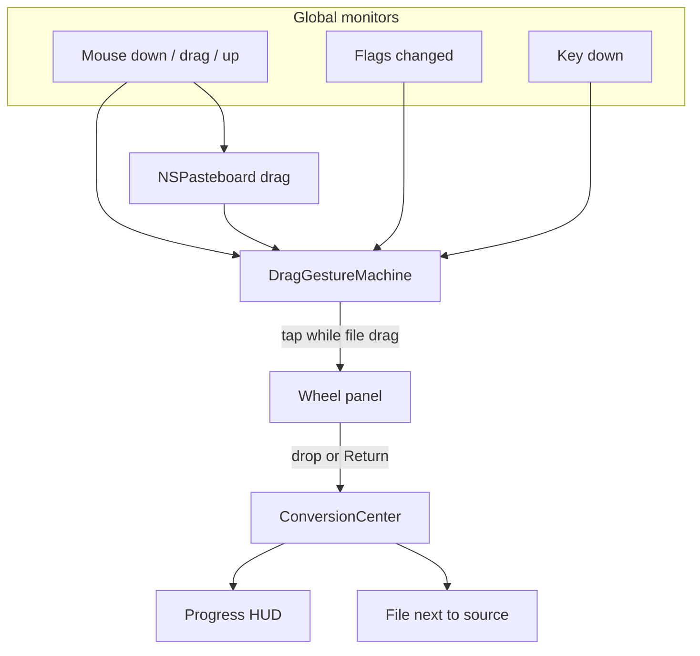

# Pith

Pith is a personal macOS menu-bar app. Drag a file, tap a modifier, and a radial wheel appears under the pointer. Drop on a segment and the conversion is written next to the source.

Interaction model: a glass donut wheel under the pointer, a red-orange hover wedge, a centre pill, a small progress HUD, and warm tool windows. The menu-bar glyph is a plain template donut. Finder uses a separate slate squircle with a picture plate, from `App/Assets.xcassets`.

Bundle id: `com.kevinzheng.pith`. Deployment target: macOS 14. The app is not sandboxed and is not distributed through the App Store.

## Build

On the Mac:

```bash
brew install xcodegen
xcodegen generate
open Pith.xcodeproj
```

Sign with a personal team (Signing & Capabilities → your Apple ID team), then Run. Do not `codesign -s -`. Ad-hoc signatures change the cdhash every rebuild, and macOS then forgets the Accessibility grant.

The first launch asks for Accessibility. Grant it under Privacy & Security → Accessibility, then drag a file in Finder and tap Shift. Command opens tools. Control opens actions. Escape dismisses the wheel and leaves the drag going. The wheel stays where it appeared until you drop, press Escape, or release the mouse.

Login items (`SMAppService.mainApp`) are most reliable once Pith lives in `/Applications`.

Core logic is a Swift package, `PithCore`, with no AppKit. On this Linux checkout:

```bash
export PATH=/opt/swift/usr/bin:$PATH
swift test
```

`swift test` does not compile `App/`. Xcode is the first place the AppKit target is built.

## How a drag becomes a file



`DragGestureMachine` ignores a stale drag pasteboard: if `changeCount` has not moved since mouse-down, nothing is a file drag. A tap is a press and release of one modifier, under 300 ms, with no other key. The same modifier again does not dismiss the wheel. A different modifier switches wheels.

The panel is a borderless non-activating `NSPanel` (floating, all spaces, transparent), 436 pt square so the 400 pt wheel sits in the middle. Hit testing uses y-down geometry, matching SwiftUI. The hole in the donut is empty on purpose: the system drag image shows through it. The blue filename pill and the green plus are Finder chrome.

## Feature matrix

| Phase | What | Status |
| --- | --- | --- |
| 1 | Global mouse, flags, and key monitors. Stale-pasteboard filter. Accessibility prompt. | Logic tested on Linux. Monitors live in `App/Drag` and have not been compiled here. |
| 2 | Glass wheel, hover, drop, dismiss on mouse-up, Escape, or drop. | Geometry and tap rules tested. SwiftUI panel not compiled here. |
| 3 | Video and audio via ffmpeg, with AVFoundation for mp4↔mov and m4a. Progress HUD. Cancel from the menu bar. | ffmpeg argument builders and progress parsing tested. `Process` / `AVAssetExportSession` not compiled here. |
| 4 | pandoc, LibreOffice headless, attributed-string fallback, CSV↔TSV, SRT↔VTT, zip/tar. PDFKit for PDF↔image and text. | Command lines, CSV, and subtitles tested. PDFKit and `soffice` not run here. |
| 5 | Command wheel: Compress, Metadata, Edit, Annotate, Add BG, Crop, Redact, plus Trim / Merge / Split. Control wheel: AirDrop, Copy, Move, Copy Path, Terminal, Reveal. Settings. | Offer lists tested. Editors and settings UI not compiled here. |
| 6 | Multi-file batches, arrow/number/Return navigation, Quick Look from notifications and Recent, file promises. | Batch naming and key navigation tested. Quick Look and promise fulfillment not compiled here. |

Image and PDF conversion do not need Homebrew. Everything else degrades: the segment stays on the wheel, dimmed, and the centre pill shows the install line.

### One-step install

```sh
scripts/install.sh          # tools + build + install + launch
scripts/install.sh --deps   # just ffmpeg, ffprobe, pandoc, LibreOffice
scripts/install.sh --app    # just build and install Pith
```

The script uses Homebrew when the current user owns it. Otherwise it installs per user: ffmpeg, ffprobe and pandoc go to `~/.local/bin`, and LibreOffice goes to `~/Applications`. Pith looks in both places.

Signing defaults to Automatic (your signed-in Apple ID team in Xcode). For Manual signing, export `PITH_TEAM` and `PITH_IDENTITY` before running `scripts/install.sh --app`.

### Homebrew

```bash
brew install ffmpeg      # video, audio, animated GIF, WebP/AVIF when ImageIO cannot write them
brew install pandoc      # DOCX, Markdown, HTML, EPUB, RTF, TXT
brew install --cask libreoffice   # PPTX/PPT/XLSX/DOCX → PDF, spreadsheets ↔ CSV
```

`ffmpeg` is expected at `/opt/homebrew/bin`, `/usr/local/bin`, or `PATH`. `soffice` is also checked inside `LibreOffice.app`. Settings can override each path. Video prefers `h264_videotoolbox` / `hevc_videotoolbox` and falls back to a software encoder.

## Design tokens

All sampled colour, type, and wheel geometry live in `App/UI/Theme.swift`.

- Wheel diameter 400 pt, inner radius 0.40 of the outer, gap 6.5°, corner radius 18.
- Highlight `#EB4420` (235, 68, 32). Cream glass tint `(1.00, 0.86, 0.68)` over an `NSVisualEffectView` (`.popover` for the wheel, `.hudWindow` for the progress card).
- Format labels are uppercase, bold, tracked. Tool labels sit under an SF Symbol.
- Appear animation: scale 0.84 → 1 and fade, spring response 0.32, damping 0.74.
- Format wheel for a PDF, clockwise from 12 o'clock: DOCX, JPG, PNG, TXT. The centre pill shows the hovered label, or the file size (`1.2 MB`) when nothing is hovered.
- Image wheel, clockwise from 12: PNG, WEBP, HEIC, TIFF, AVIF, BMP, PDF, GIF.
- Tool wheel, clockwise from 12: COMPRESS, METADATA, EDIT, ANNOTATE, ADD BG, CROP, REDACT.

SwiftUI previews in `App/Preview/PithPreviews.swift` hard-code those three wheels, the “Converting to JPG” HUD, and the Crop, Add BG, Annotate, Redact, Edit, Metadata, and Compress windows. Open them in the Xcode canvas to review layout without a live drag.

### Visual gaps

- Image wheel last slot is GIF (not DOCX). DOCX is not an image target, and a JPEG wheel that included it would not match the other seven labels.
- Previews paint a gradient stand-in for the desktop. The real panel blurs whatever is behind the cursor, so the cream wedges shift with the wallpaper. The canvas cannot show that blur.
- Segment outlines are a polyline arc (28 steps) plus quadratic corners, in y-down space. A true `addArc` would fight that coordinate system.
- Tracking, corner radius, and the 6.5° gap are tuned for a 400 pt control. If a wedge looks tight, change `PithTheme` only.
- The system drag image, the blue filename capsule, and the green plus badge are not drawn by Pith.
- SF Pro is the system font at the sizes in `PithTheme`. It is not bundled.
- Crop uses orange corner handles and an even-odd dim outside the rect. Add BG uses padding, corner, and shadow sliders plus gradient and solid swatches.

## Layout

```
Package.swift              PithCore (Linux-testable)
project.yml                XcodeGen. Run xcodegen generate. The xcodeproj is gitignored.
Sources/PithCore/          gestures, file types, offers, ffmpeg/pandoc/soffice argv, naming
Tests/PithCoreTests/
App/PithMain.swift         menu-bar entry, wiring
App/Assets.xcassets/       macOS AppIcon (824 squircle on a 1024 canvas, all sizes)
App/UI/Theme.swift         design tokens
App/UI/WheelView.swift     donut
App/UI/WheelPanel.swift    panel and drop destination
App/UI/ProgressHUD.swift
App/UI/Editors/            Crop, Add BG, Annotate, Redact, Metadata, Edit, Compress, Trim
App/Preview/PithPreviews.swift
App/Drag/                  monitors and drag pasteboard
App/Conversion/            ImageIO, PDFKit, AVFoundation, Process, notifications
App/Actions/FileActions.swift
App/QuickLook.swift
```

## Tests

`swift test` runs the `PithCore` package only (Linux-friendly). Last run here: 47 tests, 0 failures — gesture state machine, wheel hit testing, keyboard navigation, output names, offer order, ffmpeg/pandoc/soffice argv, CSV↔TSV, crop aspect math.

The `App/` target needs Xcode (AppKit, ImageIO, PDFKit, AVFoundation, SwiftUI). Sign with a personal team; avoid ad-hoc (`codesign -s -`) so Accessibility grants survive rebuilds.

## Output names

Beside the source, collisions become `name 2.ext`, then `name 3.ext`. A conversion never overwrites the file you dropped. Tool suffixes: `Page 001 Cropped.jpg`, plus `Background`, `Annotated`, `Redacted`, `Edited`, `Compressed`, `Clean`, `Trimmed`, `Merged`. Multi-page PDF renders use `name page N.ext`. File-promise drags land in a temp directory and are then written to Downloads, or to the fixed folder from Settings.

## License

MIT. See [LICENSE](LICENSE).
