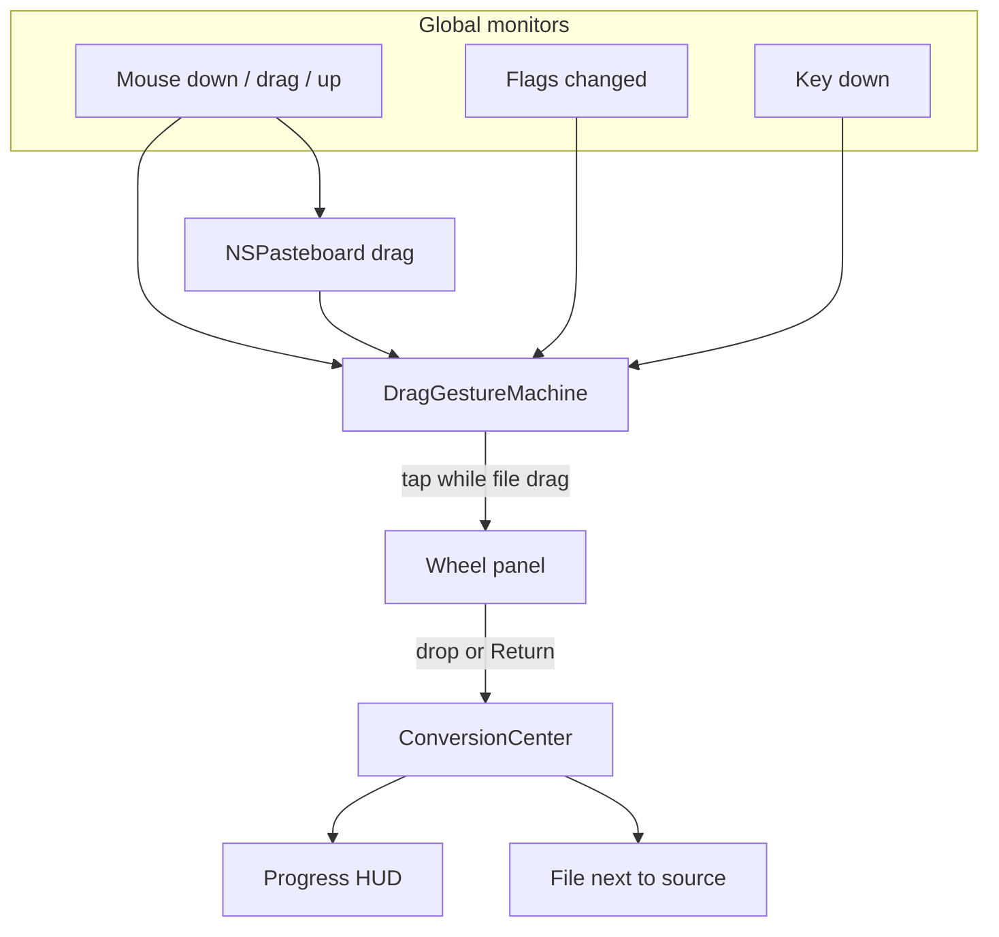

# Pith

Pith is a personal macOS menu-bar app. Drag a file, tap a modifier, and a radial wheel appears under the pointer. Drop on a segment and the conversion is written next to the source.

The interaction and the look follow a menu-bar converter's author demo: a glass donut, a red-orange hover wedge, a centre pill, a small progress HUD, and warm tool windows. Pith does not use that app's name, logo, or icon. The menu-bar glyph is a plain template donut.

Bundle id: `com.kevinzheng.pith`. Deployment target: macOS 14. The app is not sandboxed. It is for personal use, not the App Store.

## Build

On the Mac:

```bash
brew install xcodegen
xcodegen generate
open Pith.xcodeproj
```

Sign with a personal team (Signing & Capabilities → your Apple ID team), then Run. Do not `codesign -s -`. Ad-hoc signatures change the cdhash every rebuild, and macOS then forgets the Accessibility grant.

The first launch asks for Accessibility. Grant it under Privacy & Security → Accessibility, then drag a file in Finder and tap Shift. Command opens tools. Control opens actions. Escape dismisses the wheel and leaves the drag going. The wheel stays where it appeared until you drop, press Escape, or release the mouse.

Login items (`SMAppService.mainApp`) are most reliable once Pith lives in `/Applications`.

Core logic is a Swift package, `PithCore`, with no AppKit. On this Linux checkout:

```bash
export PATH=/opt/swift/usr/bin:$PATH
swift test
```

`swift test` does not compile `App/`. Xcode is the first place the AppKit target is built.

## How a drag becomes a file



`DragGestureMachine` ignores a stale drag pasteboard: if `changeCount` has not moved since mouse-down, nothing is a file drag. A tap is a press and release of one modifier, under 300 ms, with no other key. The same modifier again does not dismiss the wheel. A different modifier switches wheels.

The panel is a borderless non-activating `NSPanel` (floating, all spaces, transparent), 436 pt square so the 400 pt wheel sits in the middle. Hit testing uses y-down geometry, matching SwiftUI. The hole in the donut is empty on purpose: the system drag image shows through it. The blue filename pill and the green plus are Finder chrome.

## Feature matrix

| Phase | What | Status |
| --- | --- | --- |
| 1 | Global mouse, flags, and key monitors. Stale-pasteboard filter. Accessibility prompt. | Logic tested on Linux. Monitors live in `App/Drag` and have not been compiled here. |
| 2 | Glass wheel, hover, drop, dismiss on mouse-up, Escape, or drop. | Geometry and tap rules tested. SwiftUI panel not compiled here. |
| 3 | Video and audio via ffmpeg, with AVFoundation for mp4↔mov and m4a. Progress HUD. Cancel from the menu bar. | ffmpeg argument builders and progress parsing tested. `Process` / `AVAssetExportSession` not compiled here. |
| 4 | pandoc, LibreOffice headless, attributed-string fallback, CSV↔TSV, SRT↔VTT, zip/tar. PDFKit for PDF↔image and text. | Command lines, CSV, and subtitles tested. PDFKit and `soffice` not run here. |
| 5 | Command wheel: Compress, Metadata, Edit, Annotate, Add BG, Crop, Redact, plus Trim / Merge / Split. Control wheel: AirDrop, Copy, Move, Copy Path, Terminal, Reveal. Settings. | Offer lists tested. Editors and settings UI not compiled here. |
| 6 | Multi-file batches, arrow/number/Return navigation, Quick Look from notifications and Recent, file promises. | Batch naming and key navigation tested. Quick Look and promise fulfillment not compiled here. |

Image and PDF conversion do not need Homebrew. Everything else degrades: the segment stays on the wheel, dimmed, and the centre pill shows the install line.

### One-step install

```sh
scripts/install.sh          # tools + build + install + launch
scripts/install.sh --deps   # just ffmpeg, ffprobe, pandoc, LibreOffice
scripts/install.sh --app    # just build and install Pith
```

The script uses Homebrew when the current user owns it. Otherwise it installs per user: ffmpeg, ffprobe and pandoc go to `~/.local/bin`, and LibreOffice goes to `~/Applications`. Pith looks in both places.

### Homebrew

```bash
brew install ffmpeg      # video, audio, animated GIF, WebP/AVIF when ImageIO cannot write them
brew install pandoc      # DOCX, Markdown, HTML, EPUB, RTF, TXT
brew install --cask libreoffice   # PPTX/PPT/XLSX/DOCX → PDF, spreadsheets ↔ CSV
```

`ffmpeg` is expected at `/opt/homebrew/bin`, `/usr/local/bin`, or `PATH`. `soffice` is also checked inside `LibreOffice.app`. Settings can override each path. Video prefers `h264_videotoolbox` / `hevc_videotoolbox` and falls back to a software encoder.

## Design tokens

All sampled colour, type, and wheel geometry live in `App/UI/Theme.swift`.

- Wheel diameter 400 pt, inner radius 0.40 of the outer, gap 6.5°, corner radius 18.
- Highlight `#EB4420` (235, 68, 32). Cream glass tint `(1.00, 0.86, 0.68)` over an `NSVisualEffectView` (`.popover` for the wheel, `.hudWindow` for the progress card).
- Format labels are uppercase, bold, tracked. Tool labels sit under an SF Symbol.
- Appear animation: scale 0.84 → 1 and fade, spring response 0.32, damping 0.74.
- Format wheel for a PDF, clockwise from 12 o'clock: DOCX, JPG, PNG, TXT. The centre pill shows the hovered label, or the file size (`1.2 MB`) when nothing is hovered.
- Image wheel, clockwise from 12: PNG, WEBP, HEIC, TIFF, AVIF, BMP, PDF, GIF.
- Tool wheel, clockwise from 12: COMPRESS, METADATA, EDIT, ANNOTATE, ADD BG, CROP, REDACT.

SwiftUI previews in `App/Preview/PithPreviews.swift` hard-code those three wheels, the “Converting to JPG” HUD, and the Crop, Add BG, Annotate, Redact, Edit, Metadata, and Compress windows. Open them in the Xcode canvas against the demo frames.

### Visual gaps

- The demo's image wheel showed DOCX in the last slot. Pith puts GIF there. DOCX is not an image target, and a JPEG wheel that included it would not match the other seven labels.
- Previews paint the demo wallpaper as a gradient. The real panel blurs whatever is behind the cursor, so the cream wedges shift with the desktop. The canvas cannot show that blur.
- Segment outlines are a polyline arc (28 steps) plus quadratic corners, in y-down space. A true `addArc` would fight that coordinate system.
- Tracking, corner radius, and the 6.5° gap are sampled from a 720p frame of a 400 pt control. If a wedge looks tight against the frame, change `PithTheme` only.
- The system drag image, the blue filename capsule, and the green plus badge are not drawn by Pith.
- SF Pro is the system font at the sizes in `PithTheme`. It is not bundled.
- Crop uses orange corner handles and an even-odd dim outside the rect. Add BG uses padding, corner, and shadow sliders plus the gradient and solid swatches from the frames. Both are approximations of the filmed chrome, not pixel traces of every control.

## Layout

```
Package.swift              PithCore (Linux-testable)
project.yml                XcodeGen. Run xcodegen generate. The xcodeproj is gitignored.
Sources/PithCore/          gestures, file types, offers, ffmpeg/pandoc/soffice argv, naming
Tests/PithCoreTests/
App/PithMain.swift         menu-bar entry, wiring
App/UI/Theme.swift         design tokens
App/UI/WheelView.swift     donut
App/UI/WheelPanel.swift    panel and drop destination
App/UI/ProgressHUD.swift
App/UI/Editors/            Crop, Add BG, Annotate, Redact, Metadata, Edit, Compress, Trim
App/Preview/PithPreviews.swift
App/Drag/                  monitors and drag pasteboard
App/Conversion/            ImageIO, PDFKit, AVFoundation, Process, notifications
App/Actions/FileActions.swift
App/QuickLook.swift
```

## What was verified here

`swift test` runs the package only. Last run: 47 tests, 0 failures, covering the gesture state machine, wheel hit testing, keyboard navigation, output names, offer order for PDF / JPEG / video / audio / documents, ffmpeg argv (including videotoolbox-then-software and the GIF palette pass), pandoc and soffice argv, CSV↔TSV quoting, and crop aspect math.

Not compilable on this machine: anything under `App/`. There is no AppKit, ImageIO, PDFKit, AVFoundation, or SwiftUI.

## AppKit APIs to check first in Xcode

These are the calls most likely to be wrong. The names match the headers I aimed at; the signatures still want a real SDK.

1. `NSFilePromiseReceiver.readableDraggedTypes` — mapped with `NSPasteboard.PasteboardType($0)`. If the SDK already returns pasteboard types, that map will not compile. Drop the conversion.
2. `NSFilePromiseReceiver.receivePromisedFiles(atDestination:options:operationQueue:reader:)`. `beginReceive` calls it synchronously inside `performDragOperation`, before the drag pasteboard dies. Confirm Photos, Mail, and browser promises still deliver.
3. Global `keyDown` during a Finder drag. The monitor is installed, and `WheelNavigation` handles arrows, 1–9, and Return. A foreign drag loop may never deliver `keyDown` to a global monitor. Global monitors also cannot consume the event. If arrows do nothing while dragging, that is this limitation, not the wheel math.
4. `kAXTrustedCheckOptionPrompt.takeUnretainedValue() as String` inside `AXIsProcessTrustedWithOptions`. The prompt runs only from the onboarding button and the menu, not on every launch.
5. `NSAttributedString.DocumentType.officeOpenXML` for DOCX without pandoc.
6. `PDFPage.draw(with:to:)` and `PDFPage(image:)`.
7. `AVAssetExportSession.exportAsynchronously` and `session.progress` on macOS 14. The async `export(to:as:)` API is newer and is not used. If export throws and ffmpeg exists, the job falls back.
8. `SMAppService.mainApp` register / unregister / status, and `openSystemSettingsLoginItems()`.
9. `QLPreviewPanel` from an `LSUIElement` app. `QuickLook.swift` orders a 8 pt borderless window, makes a view first responder, and adopts the panel. If the panel never appears, this responder chain is the first place to look. Recent items fall back to revealing in Finder when the path is missing.
10. `NSWorkspace.open(_:withApplicationAt:configuration:)` for Terminal. It opens the folder in Terminal.app; it does not `cd` a new shell beyond what Terminal does with a folder URL.
11. `sender.draggingLocation` is window-base, y-up. The wheel flips it before hit testing. If the highlight is mirrored vertically, that flip is the suspect.
12. The SwiftUI hosting view is not registered for drags, so the drop should hit `WheelDropView` underneath. If drops never land, register the hosting view or make it `hitTest` to nil outside the wedges.
13. WebP and AVIF writes go through ImageIO first and ffmpeg on failure. ImageIO write support varies by macOS point release.
14. Accessibility for a personal-team build survives rebuilds. An ad-hoc signature does not.

## Output names

Beside the source, collisions become `name 2.ext`, then `name 3.ext`. A conversion never overwrites the file you dropped. Tool suffixes follow the frames: `Page 001 Cropped.jpg`, plus `Background`, `Annotated`, `Redacted`, `Edited`, `Compressed`, `Clean`, `Trimmed`, `Merged`. Multi-page PDF renders use `name page N.ext`. File-promise drags land in a temp directory and are then written to Downloads, or to the fixed folder from Settings.
